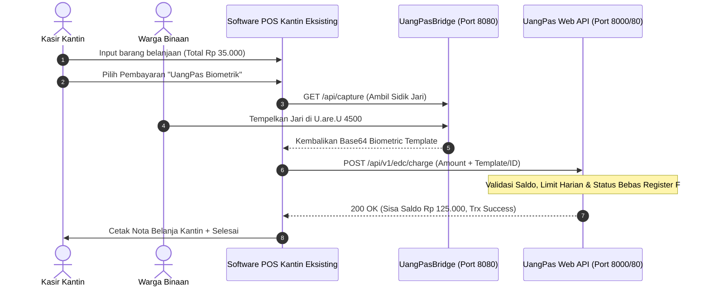

# 🔌 PANDUAN INTEGRASI OPEN API - TERMINAL KASIR KANTIN
# UANGPAS DIGITAL WALLET & BIOMETRIC CORE-BANKING
### Spesifikasi Teknis Bagi Vendor Software POS Eksternal & Pengembang Aplikasi Pihak Ketiga

---

## 1. PENDAHULUAN
Dokumentasi ini ditujukan bagi **Vendor Perangkat Lunak POS (Point of Sale)** atau tim IT pengelola kantin/koperasi di lingkungan Lapas/Rutan yang telah memiliki aplikasi kasir sendiri (retail, kantin, wartelsuspas, laundry) dan ingin menerima pembayaran non-tunai dari dompet digital WBP menggunakan **UangPas Open API**.

Dengan integrasi ini:
* Kantin **TIDAK PERLU** mengganti sistem kasir katalog/struk yang sudah berjalan.
* Cukup menambahkan satu tombol metode pembayaran baru di layar POS kasir Anda: **[ Bayar via UangPas / Biometrik ]**.
* Transaksi pemotongan saldo berjalan secara atomik (aman dari *double-spending*), memvalidasi batas limit belanja harian WBP, dan tercatat otomatis dalam **Buku Register D Kemenkumham**.

---

## 2. ARSITEKTUR KONEKSI & ALUR KERJA (WORKFLOW)



---

## 3. KONFIGURASI DASAR & ENDPOINT BASE URL

* **Base URL Lokal UangPas Core**: `http://127.0.0.1:8000/api/v1/edc` *(atau alamat IP server Lapas, contoh: `http://192.168.1.100/api/v1/edc`)*
* **Base URL Biometrik Sensor Bridge**: `http://127.0.0.1:8080/api` *(Service lokal untuk komunikasi USB hardware DigitalPersona U.are.U 4500)*
* **Content-Type**: `application/json`
* **Accept**: `application/json`

---

## 4. SPESIFIKASI ENDPOINT API

### 4.1 Cek Saldo & Status WBP (Pre-Transaction Check)
Digunakan sebelum pemrosesan untuk memeriksa saldo berjalan, limit belanja harian, dan apakah WBP berhak belanja.

* **Method**: `GET`
* **Endpoint**: `/api/v1/edc/inmate/{identifier}`
* **Parameter URL**:
  * `{identifier}`: Nomor Registrasi WBP (contoh: `BI.123/2026`), Nomor Register D (`REG-D/2026/00012`), atau ID Database.

#### Contoh Request:
```bash
curl -X GET "http://127.0.0.1:8000/api/v1/edc/inmate/BI.123/2026" \
  -H "Accept: application/json"
```

#### Contoh Response Berhasil (HTTP 200):
```json
{
  "success": true,
  "data": {
    "id": 12,
    "no_registrasi": "BI.123/2026",
    "register_d_number": "REG-D/2026/00012",
    "nama": "Ahmad Fauzi",
    "blok_kamar": "Blok B / Kamar 04",
    "saldo": 150000,
    "saldo_formatted": "Rp 150.000",
    "limit_harian": 100000,
    "limit_harian_formatted": "Rp 100.000",
    "today_spent": 20000,
    "today_spent_formatted": "Rp 20.000",
    "remaining_daily_limit": 80000,
    "remaining_daily_limit_formatted": "Rp 80.000",
    "status": "aktif",
    "has_fingerprint": true
  }
}
```

#### Contoh Response Gagal / WBP Isolasi (HTTP 403):
```json
{
  "success": false,
  "message": "Warga Binaan Ahmad Fauzi saat ini berstatus ISOLASI (Register F). Transaksi keuangan dibekukan.",
  "status": "isolasi"
}
```

---

### 4.2 Eksekusi Potong Saldo (Charge / Debit WBP)
Endpoint inti untuk mendebit saldo WBP secara langsung dari POS kantin.

* **Method**: `POST`
* **Endpoint**: `/api/v1/edc/charge`
* **Payload Parameter (JSON Body)**:

| Field | Tipe | Wajib? | Keterangan |
| :--- | :--- | :--- | :--- |
| `amount` | Number | **Ya** | Nominal yang dipotong (minimal 1 rupiah) |
| `identifier` | String | Opsional* | No. Reg / No. Register D / NIK WBP |
| `inmate_id` | Integer | Opsional* | ID database WBP (jika sudah didapatkan) |
| `biometric_template` | String | Opsional* | Template base64 sidik jari dari sensor U.are.U 4500 (untuk otentikasi biometrik murni) |
| `merchant` | String | Opsional | Nama stan kantin (contoh: `"Kantin Blok A"`, default: `"Kantin Koperasi"`) |
| `cashier_name` | String | Opsional | Nama petugas/operator kasir POS |
| `notes` | String | Opsional | Keterangan nota POS kantin (contoh: `"Struk POS #INV-9821 Nasi Goreng + Es Teh"`) |
| `external_reference` | String | Opsional | Nomor nota transaksi internal di software POS Anda untuk rekonsiliasi |

*\*Catatan: Minimal sertakan salah satu dari: `identifier`, `inmate_id`, atau `biometric_template`.*

#### Contoh Payload Request:
```json
{
  "amount": 25000,
  "identifier": "BI.123/2026",
  "merchant": "Kantin Blok B",
  "cashier_name": "Kasir Stan 02",
  "external_reference": "POS-KNTN-20261021-0042",
  "notes": "Belanja Kebutuhan Pokok & Sabun Mandi"
}
```

#### Contoh Response Sukses (HTTP 200):
```json
{
  "success": true,
  "message": "Pembayaran berhasil diproses sebesar Rp 25.000.",
  "data": {
    "transaction_id": 842,
    "invoice_no": "TRX-20261021-842",
    "reference_id": "EDC-20261021-0042",
    "external_reference": "POS-KNTN-20261021-0042",
    "amount": 25000,
    "amount_formatted": "Rp 25.000",
    "inmate": {
      "id": 12,
      "nama": "Ahmad Fauzi",
      "no_registrasi": "BI.123/2026",
      "register_d_number": "REG-D/2026/00012",
      "blok_kamar": "Blok B / Kamar 04",
      "sisa_saldo": 125000,
      "sisa_saldo_formatted": "Rp 125.000",
      "today_spent": 45000,
      "remaining_daily_limit": 55000,
      "remaining_daily_limit_formatted": "Rp 55.000"
    },
    "receipt_print_url": "http://127.0.0.1:8000/edc/receipt/842",
    "timestamp": "2026-10-21 11:35:12"
  }
}
```

#### Contoh Response Error: Saldo Tidak Mencukupi (HTTP 422):
```json
{
  "success": false,
  "error_code": "INSUFFICIENT_BALANCE",
  "message": "Saldo Warga Binaan tidak mencukupi. Sisa saldo saat ini: Rp 15.000, Tagihan: Rp 25.000"
}
```

#### Contoh Response Error: Melebihi Batas Belanja Harian (HTTP 422):
```json
{
  "success": false,
  "error_code": "DAILY_LIMIT_EXCEEDED",
  "message": "Transaksi ditolak. Melebihi batas belanja harian. Sisa kuota belanja WBP hari ini adalah Rp 10.000."
}
```

---

### 4.3 Sinkronisasi Master WBP (Untuk Autocomplete / Offline Cache)
Mengambil daftar seluruh Warga Binaan aktif untuk fitur pencarian nama instan pada layar POS kasir.

* **Method**: `GET`
* **Endpoint**: `/api/v1/edc/inmates`

#### Contoh Response:
```json
{
  "success": true,
  "total": 450,
  "data": [
    {
      "id": 1,
      "nama": "Ahmad Fauzi",
      "no_registrasi": "BI.123/2026",
      "register_d_number": "REG-D/2026/00012",
      "blok": "Blok B",
      "kamar": "04",
      "saldo": 125000,
      "limit_harian": 100000,
      "has_fingerprint": true
    }
  ]
}
```

---

## 5. INTEGRASI HARDWARE BIOMETRIK (UANGPASBRIDGE PORT 8080)

Jika aplikasi kasir POS Anda berbasis web (browser) atau desktop yang tidak memiliki driver C++ DigitalPersona, Anda dapat menggunakan **UangPasBridge**:

### 5.1 Cek Konektivitas Sensor:
* `GET http://127.0.0.1:8080/api/status`
* Response: `{"status":"ready","connected":true,"device":"DigitalPersona U.are.U 4500"}`

### 5.2 Ambil Sidik Jari (Capture):
* `POST http://127.0.0.1:8080/api/capture`
* Tunggu WBP menaruh jarinya pada sensor kaca.
* Response:
  ```json
  {
    "success": true,
    "quality": "good",
    "template_base64": "Rk1SACAyMAAAAA..."
  }
  ```
Kirimkan string `template_base64` ini ke endpoint `POST /api/v1/edc/charge` pada parameter `biometric_template`.

---

## 6. CONTOH KODE IMPLEMENTASI LENGKAP

### 6.1 Contoh JavaScript / Fetch (Web POS Kantin):
```javascript
async function bayarDenganUangPas(nominalBelanja, noRegistrasiWbp) {
    try {
        const response = await fetch('http://127.0.0.1:8000/api/v1/edc/charge', {
            method: 'POST',
            headers: {
                'Content-Type': 'application/json',
                'Accept': 'application/json'
            },
            body: JSON.stringify({
                amount: nominalBelanja,
                identifier: noRegistrasiWbp,
                merchant: 'Kantin Koperasi Utama',
                cashier_name: 'Budi (Kasir 1)',
                external_reference: 'INV-' + Date.now()
            })
        });

        const result = await response.json();

        if (response.ok && result.success) {
            alert(`✅ Transaksi Berhasil!\nSisa Saldo: ${result.data.inmate.sisa_saldo_formatted}`);
            // Buka struk thermal UangPas jika diperlukan
            window.open(result.data.receipt_print_url, '_blank', 'width=350,height=500');
            return true;
        } else {
            alert('❌ Gagal: ' + result.message);
            return false;
        }
    } catch (err) {
        alert('Koneksi ke Server UangPas Terputus: ' + err.message);
        return false;
    }
}
```

### 6.2 Contoh C# (.NET WinForms / WPF):
```csharp
using System;
using System.Net.Http;
using System.Text;
using System.Threading.Tasks;
using Newtonsoft.Json;

public class UangPasClient
{
    private static readonly HttpClient client = new HttpClient();
    private const string BASE_URL = "http://127.0.0.1:8000/api/v1/edc/charge";

    public async Task<bool> ProsesDebitAsync(decimal amount, string noReg, string noInvoicePOS)
    {
        var payload = new
        {
            amount = amount,
            identifier = noReg,
            merchant = "Kantin Stan 01",
            cashier_name = "Operator POS",
            external_reference = noInvoicePOS
        };

        var json = JsonConvert.SerializeObject(payload);
        var content = new StringContent(json, Encoding.UTF8, "application/json");

        HttpResponseMessage res = await client.PostAsync(BASE_URL, content);
        string resBody = await res.Content.ReadAsStringAsync();

        if (res.IsSuccessStatusCode)
        {
            Console.WriteLine("Debit Berhasil: " + resBody);
            return true;
        }
        else
        {
            Console.WriteLine("Gagal: " + resBody);
            return false;
        }
    }
}
```

---

## 7. BANTUAN TEKNIS
Jika membutuhkan bantuan integrasi driver SDK atau pengujian endpoint, hubungi tim pengembang UangPas atau buka tiket pengujian di portal sistem.
